# Diseño de una arquitectura Big Data para el monitoreo de transacciones financieras

> **Borrador académico en Markdown — versión para revisión, 22 de octubre de 2026**  
> Este documento es la fuente de contenido para preparar el informe final en Microsoft Word. Los campos entre corchetes deben completarse antes de entregar. La evidencia descrita procede de una aplicación didáctica local con datos sintéticos; no representa una plataforma financiera de producción.

## Portada

**Universidad Amazónica de Pando**  
**Maestría en Big Data y Analítica de Datos (V1 G1 2025 S28 U49)**  
**Módulo 10:** Diseño de Arquitecturas para Sistemas de Big Data  

### Diseño de una arquitectura Big Data para el monitoreo de transacciones financieras

**Informe aplicado**

**Autor(es):** [Nombre completo / integrantes del grupo]  
**Docente:** MSc. Ing. Marcelo Fernando Condori Mendoza  
**Sede:** Sucre  
**Lugar:** [Ciudad, Bolivia]  
**Fecha:** 22 de octubre de 2026

---

## Resumen

Este trabajo documenta la ejecución, revisión y mejora de un proyecto académico que representa un sistema de monitoreo de transacciones financieras mediante componentes y conceptos de Big Data. La aplicación genera transacciones sintéticas y presenta cinco áreas: procesamiento por lotes y capas Bronze/Silver/Gold; comparación conceptual entre batch y streaming; tolerancia a fallos mediante Circuit Breaker; simulación de recuperación ante desastres; y estrategias de sharding y replicación.

La versión local se ejecutó con Python 3.12.3 en Linux, dentro de un entorno virtual. Se instaló el conjunto base de dependencias, se ejecutó la demo completa, se abrió el dashboard Streamlit y se ejecutaron módulos individuales. La revisión inicial permitió detectar fallos y resultados inconsistentes. Se corrigió una latencia negativa en la simulación de replicación, se cambió la clave usada para distribuir transacciones entre shards y se modificó la replicación del simulador DRP para copiar todos los registros pendientes. También se reemplazó una llamada de fecha UTC obsoleta y se documentó la forma correcta de invocar el módulo DRP.

En una corrida de sharding con 500 transacciones, la distribución inicial dejó un shard vacío; después del cambio, los tres shards recibieron 155, 169 y 176 registros, con un balance calculado de 88,1 %. En el simulacro DRP de 200 transacciones, la línea base reportó 100 recuperadas y 100 posiblemente perdidas; tras la mejora se reportaron 200 recuperadas, cero perdidas y cero brechas. El ETL de una corrida recibió 500 registros, conservó 499 en Silver y rechazó uno. Estas cifras son resultados de simulación local y pueden cambiar entre ejecuciones.

El proyecto demuestra flujos didácticos, pero no ejecuta en esta evidencia un clúster real distribuido, almacenamiento Delta, replicación entre regiones ni servicios externos de monitoreo. El informe distingue por ello la arquitectura conceptual del comportamiento realmente ejecutado.

**Palabras clave:** Big Data, arquitectura Lambda, ETL, lakehouse, sharding, replicación, Circuit Breaker, DRP, RTO, RPO.

## Índice propuesto para Word

Al maquetar en Word, generar el índice automáticamente a partir de los estilos de encabezado. El orden de este borrador es:

1. Introducción
2. Objetivos
3. Alcance y método de trabajo
4. Marco teórico
5. Descripción de la solución
6. Implementación aplicada
7. Mejoras y resultados comparativos
8. Limitaciones
9. Conclusiones
10. Recomendaciones
11. Referencias
12. Anexos

## 1. Introducción

Las organizaciones que procesan pagos, transferencias y otras operaciones financieras necesitan registrar grandes cantidades de eventos y analizarlos con oportunidad. Además del volumen, importa la velocidad de llegada, la variedad de campos, la calidad de los datos y la utilidad de los resultados para la toma de decisiones. Un sistema de monitoreo puede combinar la conservación de eventos, la validación de registros, la generación de indicadores y mecanismos que eviten que un fallo temporal de un servicio se propague al resto de la aplicación.

El proyecto objeto de este informe presenta ese escenario mediante datos sintéticos. Incluye un generador de transacciones, módulos Python para procesar lotes y simular componentes de resiliencia, una interfaz Streamlit, un DAG de Apache Airflow y una configuración Docker para servicios como Kafka, PostgreSQL y SeaweedFS. El objetivo de este trabajo no es afirmar que todos esos servicios se ejecutaron como una plataforma distribuida de producción, sino evaluar de forma reproducible los componentes disponibles en el entorno local y documentar sus resultados.

La revisión se realizó en etapas. Primero se inspeccionó el código y el README; luego se preparó un entorno virtual, se ejecutó la demo y el dashboard, y se probaron los módulos individuales. Los resultados iniciales mostraron un fallo al comparar estrategias de replicación, una distribución hash con shard vacío y una discrepancia entre registros recuperados y perdidos en el simulacro DRP. Se implementaron correcciones puntuales y se repitieron las ejecuciones afectadas. La bitácora del proceso y las capturas organizadas se conservan en `docs/BITACORA_EJECUCION.md` y `docs/evidencias/`.

El informe se estructura en objetivos, fundamentos, método, descripción aplicada, comparación de cambios, conclusiones y recomendaciones. En cada sección se diferencia entre conceptos respaldados por fuentes técnicas, comportamiento implementado en código y resultados observados en una corrida concreta.

## 2. Objetivos

### 2.1 Objetivo general

Ejecutar, analizar y mejorar una aplicación didáctica de arquitectura Big Data para monitoreo de transacciones financieras sintéticas, documentando su funcionamiento, resultados, limitaciones y evidencias de ejecución.

### 2.2 Objetivos específicos

1. Describir los conceptos de arquitectura Lambda/Kappa, procesamiento batch y streaming, capas de datos, particionamiento, replicación, Circuit Breaker, observabilidad y recuperación ante desastres pertinentes al proyecto.
2. Preparar el entorno Python local y ejecutar la demo, el dashboard y los módulos individuales documentados en el repositorio.
3. Identificar fallos o discrepancias observables en las ejecuciones iniciales.
4. Aplicar y verificar mejoras concretas en la simulación de latencia, distribución hash, sincronización DRP y generación de marcas temporales UTC.
5. Reunir capturas auténticas y registrar los resultados y cambios para facilitar la reproducción y evaluación del trabajo.

## 3. Alcance y método de trabajo

### 3.1 Alcance

El análisis cubre la ruta de ejecución local en Python y las interfaces Streamlit observadas por el usuario. Comprende la demo de cinco bloques, el procesamiento ETL local en JSON, las simulaciones de resiliencia y el contenido de los módulos de ingesta, procesamiento, monitoreo y recuperación. También se revisaron las instrucciones de ejecución y las configuraciones Docker y Airflow para evitar atribuir capacidades no verificadas.

No se levantó el stack Docker durante estas pruebas; la inspección inicial de Docker mostró cero imágenes, contenedores y volúmenes locales. No se ejecutó el DAG en Airflow ni se verificó conexión real a Kafka, PostgreSQL, SeaweedFS, Spark o Delta Lake. Las métricas de throughput, latencias y RTO/RPO se obtuvieron en un entorno local o dentro de simulaciones, por lo que no deben interpretarse como mediciones de capacidad de producción.

### 3.2 Método

El trabajo siguió una secuencia de observación y corrección:

1. Inspección de la estructura, el README, configuración y módulos.
2. Preparación de Python 3.12.3 y del entorno virtual `.venv`.
3. Instalación del conjunto base de dependencias indicado en el README.
4. Ejecución inicial de la demo y los módulos; registro de errores, métricas y artefactos.
5. Aplicación de cambios de alcance acotado a partir de fallos reproducibles o salidas incoherentes.
6. Repetición manual de los comandos relevantes y comparación de la evidencia anterior y posterior.
7. Registro de cambios mediante commits pequeños y documentación en Markdown.

La evidencia de ejecución es manual y observacional. No se afirma que se haya ejecutado una suite de pruebas unitarias automatizada. Los números aleatorios usados por los simuladores hacen que diferentes corridas produzcan resultados distintos.

## 4. Marco teórico

### 4.1 Big Data y las dimensiones de los datos

En este trabajo se usa el marco didáctico de las cinco V: volumen, velocidad, variedad, veracidad y valor. El simulador ejemplifica volumen al generar lotes, velocidad al producir eventos de forma continua, variedad mediante campos de transacción y metadatos semiestructurados, veracidad mediante indicadores de completitud y fraude potencial, y valor a través de agregaciones que pueden alimentar un análisis. Estas dimensiones se utilizan como una lente para describir el caso; la demo no constituye por sí sola una prueba de escala masiva ni de detección financiera real.

### 4.2 Arquitecturas Lambda y Kappa

La arquitectura Lambda combina una ruta batch que procesa datos históricos con una ruta de baja latencia para los datos recientes y una capa de servicio que presenta resultados. La ruta batch puede recalcular vistas con el conjunto histórico, mientras que el flujo de velocidad reduce la demora de información reciente. La combinación introduce complejidad porque las transformaciones de ambas rutas pueden tener que mantenerse y conciliarse. La literatura sobre Lambda/Kappa resalta tanto ese propósito como los compromisos de complejidad y operación [1].

En el repositorio, la arquitectura Lambda aparece como referencia conceptual. El pipeline ETL local sí escribe archivos JSON por capas, y el simulador tiene una función generadora continua. Kafka y Flink aparecen en documentación y componentes, pero las cifras de la tabla “Batch vs Streaming” de la demo son simuladas: no provienen de una medición contra clústeres Apache Spark, Kafka o Flink reales.

### 4.3 Ingesta, batch y streaming

El procesamiento batch trabaja sobre un conjunto finito de registros y resulta adecuado para agregaciones y reprocesamiento. El streaming procesa eventos conforme llegan y se usa cuando una respuesta reciente tiene valor. Kafka organiza eventos en topics y particiones; las claves permiten dirigir eventos relacionados a una misma partición y preservar el orden dentro de ella. La documentación de Kafka describe particiones y replicación a nivel de partición [2].

El productor y consumidor Kafka forman parte del proyecto, pero la ejecución documentada en este informe no inició el broker Docker. La demo local utiliza el simulador y procesamiento en memoria/archivos, así que la comparación presentada es ilustrativa y no una evaluación de latencia de Kafka frente a Spark.

### 4.4 Lakehouse y capas Bronze, Silver y Gold

El patrón medallion organiza datos en capas de calidad progresiva: Bronze conserva datos de origen, Silver contiene datos validados y transformados, y Gold reúne vistas agregadas para análisis. La documentación de Databricks describe estas capas como un patrón de diseño para mejorar gradualmente la estructura y calidad de los datos [3]. Delta Lake, por su parte, añade transacciones ACID, manejo de metadatos y compatibilidad con procesamiento batch y streaming sobre data lakes [4].

En la prueba local, el código implementa la separación de archivos JSON en `datos/lakehouse/raw/`, `silver/` y `gold/`. El código de la demo instancia `MotorBatch(usar_spark=False)`; por tanto, esta ejecución usa la ruta local y no una tabla Delta ni un motor Spark distribuido. Los nombres de las capas describen la organización del flujo, no una implementación Delta activa.

### 4.5 Particionamiento y balance de carga

El sharding horizontal divide registros entre particiones con el objetivo de repartir almacenamiento o carga. Una clave de partición con suficiente cardinalidad y distribución adecuada ayuda a utilizar las particiones. El hash consistente dispone nodos sobre un anillo; se asigna una clave al siguiente nodo disponible en el anillo y las réplicas virtuales ayudan a refinar la distribución. Sin embargo, si se hashéan solo unas pocas claves repetidas, varios nodos pueden quedar sin registros.

El proyecto mide un balance comparando el shard con menor número de registros con el de mayor número. Esta métrica es una heurística sencilla del código, no un indicador universal de capacidad o latencia. En esta aplicación, la mejora consistió en dar prioridad a `cliente_id`, en vez de volver a hashear el campo `shard_key` que ya contenía uno de pocos nombres de shard.

### 4.6 Replicación y compromiso CAP

La replicación síncrona espera confirmación de las réplicas activas antes de declarar completa la escritura; a cambio, aumenta la latencia observada. La replicación asíncrona confirma en el líder y propaga después, reduciendo la espera a costa de una ventana potencial de divergencia. La modalidad multi-líder acepta operaciones desde más de un líder y requiere tratar conflictos. Estas son estrategias con compromisos distintos; sus nombres en la aplicación describen modelos simulados.

El teorema CAP trata los compromisos entre consistencia y disponibilidad cuando hay una partición de red; no significa simplemente que un sistema elige permanentemente dos de tres propiedades en todos los momentos. Gilbert y Lynch revisan su formalización y sus implicaciones prácticas [5]. El cuadro CAP de la demo se usa como apoyo docente y sus clasificaciones de estrategias deben leerse como simplificaciones, no como una garantía formal acerca de implementaciones reales.

### 4.7 Circuit Breaker y tolerancia a fallos

El patrón Circuit Breaker observa fallos en una operación protegida y, al superar un umbral, rechaza temporalmente nuevas llamadas para evitar agotar recursos o propagar una falla en cascada. Un estado semiabierto permite sondear la recuperación antes de cerrar el circuito. Fowler describe el patrón como un envoltorio que mide fallos, abre el circuito y devuelve error sin ejecutar la llamada protegida durante ese periodo [6]. La Figura 29 sintetiza el ciclo de estados que se ilustra en el módulo.

El módulo local simula llamadas exitosas y fallidas, cuenta resultados y cambia entre estados. No prueba una dependencia bancaria real ni una recuperación de servicio externo. El carácter aleatorio de los fallos explica que contadores y secuencias varíen entre corridas.

### 4.8 Observabilidad

La observabilidad se apoya en señales que permiten entender el comportamiento de una aplicación. OpenTelemetry define métricas, logs y trazas como señales de telemetría y explica que las trazas muestran el recorrido de una petición, las métricas cuantifican medidas en tiempo de ejecución y los logs registran eventos [7].

El módulo del proyecto implementa contadores, medidores, histogramas, trazas y reglas de alerta en memoria. Durante una corrida individual registró 94 mensajes, 6 errores y una tasa de error de 6,38 %, lo que disparó una alerta configurada sobre 5 %. No se verificó exportación a Prometheus, Grafana, Jaeger u OpenTelemetry Collector; esas integraciones son extensiones recomendables, no resultados realizados.

### 4.9 Continuidad y recuperación ante desastres

Un plan de continuidad identifica procesos críticos, escenarios de interrupción y recursos de recuperación. NIST SP 800-34 presenta un enfoque para preparar planes de contingencia de sistemas de información y define, entre otros conceptos, RTO como el límite de indisponibilidad tolerable y RPO como el punto temporal al que los datos deben poder recuperarse [8]. RTO expresa una duración de recuperación; RPO expresa la pérdida temporal de datos admisible.

El módulo DRP define procesos, sitios hot/warm/cold, replicación, failover, failback y simulacros. En el escenario probado, estos elementos y el redireccionamiento DNS/anycast son simulados dentro de un proceso Python; no hay centros de datos ni red multi-región activos. La secuencia de prueba y la restauración final del estado se representan en la Figura 28.

### 4.10 Marcas temporales UTC

Las marcas temporales deben incluir una zona horaria cuando representan UTC, para evitar interpretar una fecha ingenua como hora local. La documentación oficial de Python 3.12 marca `datetime.utcnow()` como obsoleto y recomienda objetos con zona horaria como `datetime.now(timezone.utc)` [9]. Esta recomendación motivó una mejora pequeña en el pipeline Silver.

## 5. Descripción de la solución

### 5.1 Componentes revisados

| Componente | Función declarada | Comportamiento observado en este trabajo |
|---|---|---|
| `simulador_transacciones.py` | Crear eventos sintéticos | Ejecutado; genera registros con identificadores, fechas UTC, cliente, región, moneda, canal y metadatos. |
| `motor_batch.py` | Flujo Bronze → Silver → Gold | Ejecutado localmente con JSON; limpia, transforma, agrega y guarda KPIs. |
| `circuit_breaker.py` | Controlar fallos repetidos | Ejecutado como simulación con estados y métricas. |
| `particionamiento.py` | Distribuir filas por estrategias | Ejecutado con 3 shards hash y geográficos y con particionamiento vertical en memoria. |
| `replicacion.py` | Comparar escritura síncrona, asíncrona y multi-líder | Ejecutado como simulación de nodos y latencia. |
| `plan_drp.py` | Simular contingencia y failover | Ejecutado con `python -m`; sitios, sincronización y conmutación son simulados. |
| `observabilidad.py` | Registrar señales y alertas | Ejecutado como simulación en memoria. |
| Dashboard Streamlit | Interactuar con ETL y simulaciones | Abierto localmente; el usuario informó que funcionó con normalidad. |
| DAG Airflow / Docker Compose | Orquestación y servicios | Revisados en archivos; no ejecutados en esta fase. |

### 5.2 Flujo lógico

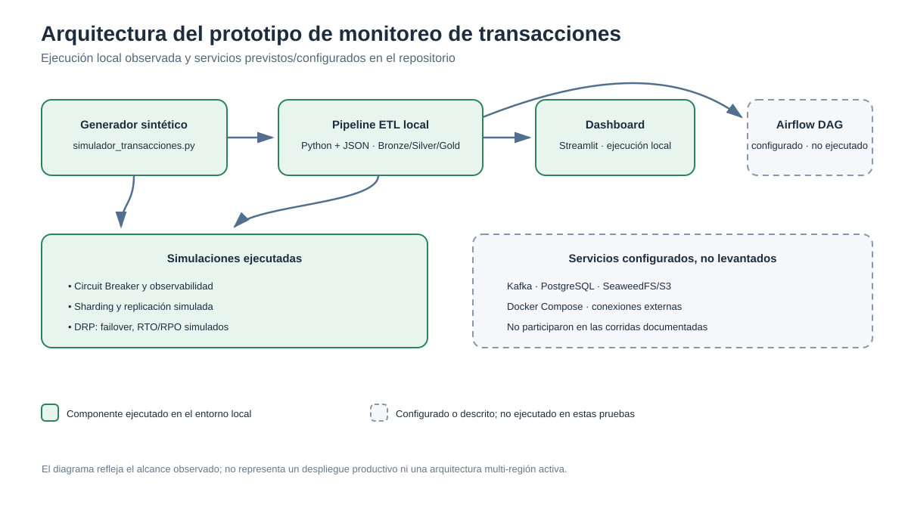

**Figura 1.** Componentes ejecutados localmente y servicios configurados pero no levantados en las pruebas; las flechas no implican integración productiva.

### 5.3 Entorno de ejecución

El entorno reportado fue Linux, Python 3.12.3 y un entorno virtual `.venv`. Se instaló el grupo base de dependencias desde pip, incluidos pandas, kafka-python, boto3, psycopg2-binary, SQLAlchemy, Streamlit, Plotly, python-dotenv, Pydantic, Tenacity, Rich, pytest y Faker. La instalación terminó con `Successfully installed`.

La ejecución local de `python demo.py` no requirió Docker. La primera revisión del inventario Docker mostró que el equipo no tenía imágenes ni contenedores del proyecto en ejecución. No se debe confundir la disponibilidad de `docker-compose.yml` con la ejecución del stack.

## 6. Implementación aplicada

### 6.1 Preparación del entorno

Se siguió el procedimiento manual del README: crear un entorno virtual, activarlo e instalar dependencias base. Se ejecutó la demo desde ese entorno y luego se abrió el dashboard con `streamlit run dashboard/app_streamlit.py`. El dashboard estuvo accesible en `http://localhost:8501` según la captura de arranque.

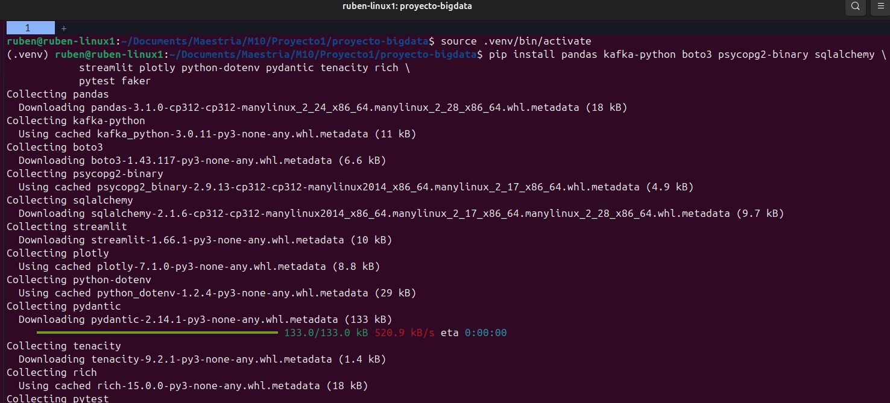

**Figura 2.** Instalación del entorno Python mostrada en terminal.

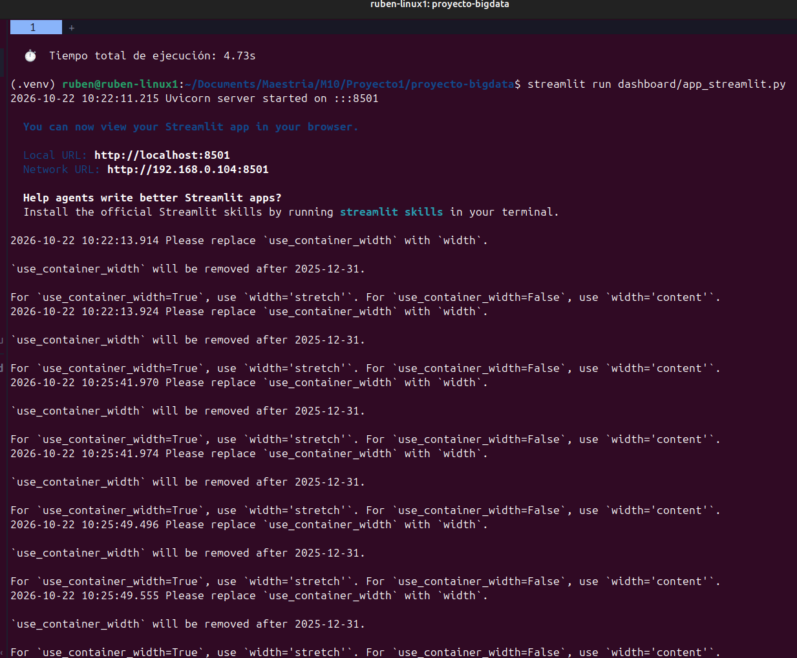

**Figura 3.** Arranque del dashboard Streamlit y URL local.

### 6.2 Ejecución integral de la demo

La demo incluye cinco bloques y una síntesis final. Una ejecución completa desde `.venv` terminó en 4,73 segundos, de acuerdo con la salida compartida. Los resultados internos varían, por lo que el tiempo no constituye un benchmark y los porcentajes de fraude o métricas de rendimiento no son valores fijos.

#### Bloque 1: datos sintéticos y ETL

El generador creó transacciones con `id_transaccion`, `timestamp_utc`, región, identificador de cliente, tipo, monto, moneda, canal, indicadores de fraude y metadatos semiestructurados. El ETL local ejecutó tres pasos:

1. **Bronze:** serializó el lote original a JSON.
2. **Silver:** descartó transacciones incompletas o con monto no positivo; estandarizó campos, convirtió montos a USD con tasas fijas ilustrativas y creó un hash corto del identificador de cliente.
3. **Gold:** calculó totales, montos promedio, mínimo y máximo, cantidad y tasa de fraude, medias de riesgo y agregados por región, tipo y categoría.

En una ejecución de la demo con 300 registros, Silver/Gold reportó 300 transacciones y un monto total de USD 850.491,00. En otra corrida compartida con el motor batch, de 500 entradas quedaron 497 válidas y 3 rechazadas; después de la corrección UTC, una nueva corrida tuvo 500 entradas, 499 válidas y 1 rechazada. Son lotes aleatorios independientes, no una discrepancia del mismo lote.

La Figura 27 resume el recorrido de los datos por Bronze, Silver y Gold, incluida la salida de registros rechazados.

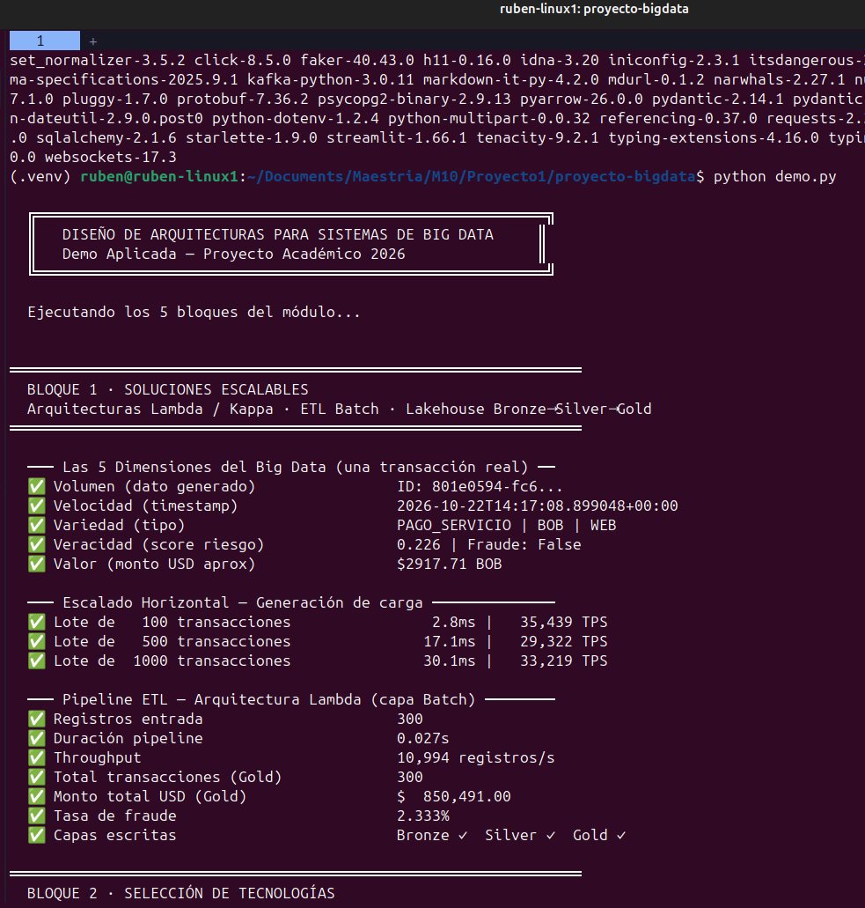

**Figura 4.** Datos sintéticos y resultado de las capas Bronze, Silver y Gold en la demo.

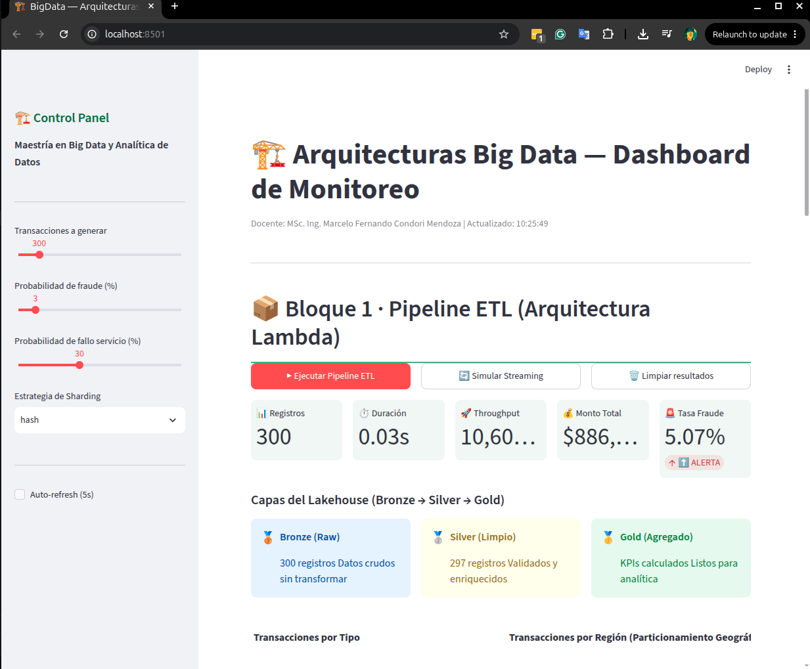

**Figura 5.** Indicadores y presentación del pipeline ETL en el dashboard.

#### Bloque 2: selección de tecnologías

La demo presenta una tabla conceptual de batch y streaming, y compara Data Lake, Data Warehouse y Lakehouse. Los rótulos Spark y Kafka/Flink son parte de una ilustración de latencia generada localmente; no se conectaron a motores reales para esa medición. En el informe final, debe presentarse como comparación didáctica y no como resultado de benchmark.

#### Bloque 3: alta disponibilidad y Circuit Breaker

La demo simula una dependencia inestable, registra llamadas, errores y rechazos cuando el circuito se encuentra abierto, espera un timeout y luego permite una llamada de prueba. En la ejecución individual reportada, el umbral fue de 3 fallos y el timeout de 5 segundos; hubo 15 intentos, 1 éxito, 4 fallos registrados y 10 rechazos mientras el circuito estuvo abierto. La secuencia depende de la aleatoriedad.

La misma área del proyecto genera métricas y trazas de observabilidad. En otra corrida del módulo de observabilidad hubo 6 errores sobre 94 mensajes, tasa de 6,38 %, y se activó una alerta crítica con umbral del 5 %. Las cifras pertenecen a ejecuciones distintas y se citan para explicar funcionalidades, no para comparar tasa del sistema.

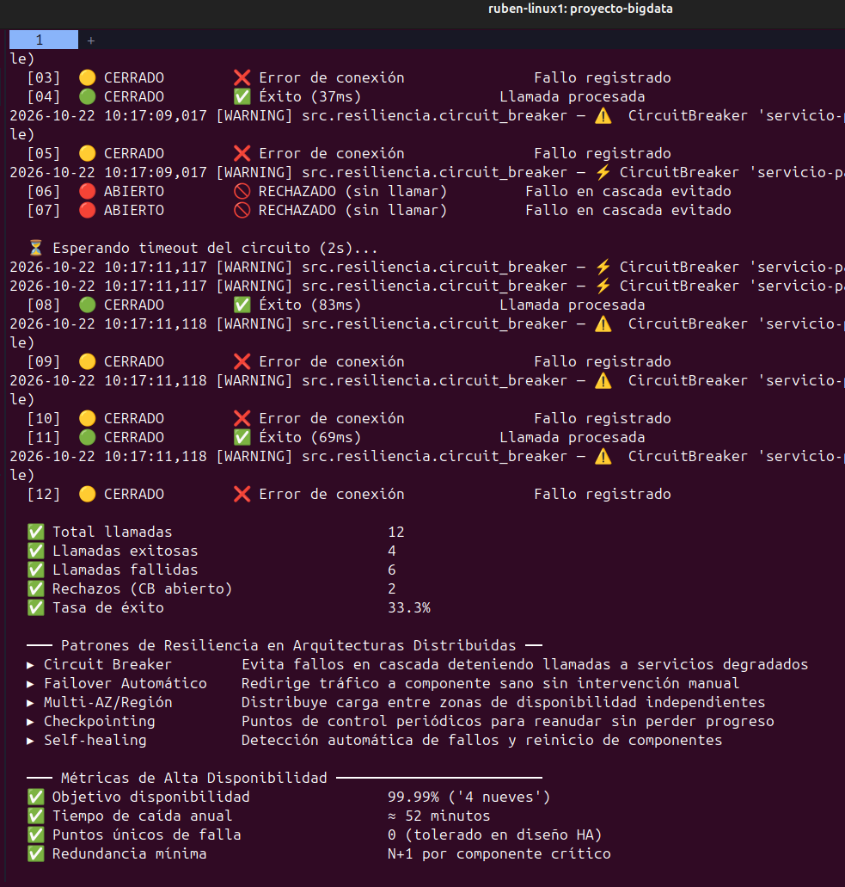

**Figura 6.** Circuito y métricas de alta disponibilidad presentados en la demo.

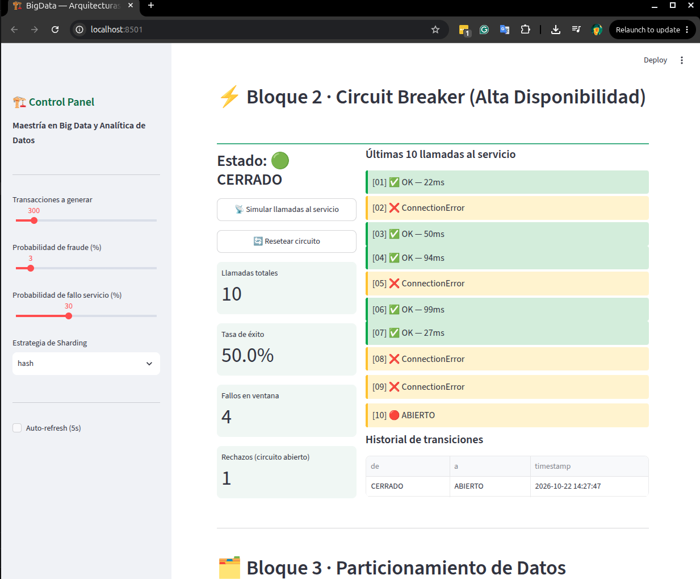

**Figura 7.** Estado y últimas llamadas mostradas en el panel interactivo.

#### Bloque 4: simulacro DRP

El módulo registra datos en el sitio primario, inicia un hilo de replicación al standby y simula la caída del sitio primario. El failover simulado activa el sitio standby, espera 0,5 segundos, informa la redirección y calcula registros disponibles, RTO y RPO. El simulacro guarda y restaura el estado previo para que la aplicación de prueba no permanezca en failover después del ensayo.

La primera corrida de 200 registros replicó solo los últimos 100, por lo que reportó 100 disponibles y 100 posiblemente perdidos. A la vez el RPO calculado por tiempo desde el último backup fue 0,03 min y se marcó cumplido frente al objetivo de 5 min. Este resultado mostró que el contador de registros omitidos y el cálculo temporal del RPO son dimensiones diferentes y que la inicialización de la réplica estaba incompleta.

Después de cambiar el ciclo para copiar todos los registros pendientes, el ensayo compartido reportó 200 disponibles, 0 posiblemente perdidos, RTO de 0,01 min y RPO de 0,03 min. No hubo brechas. Al terminar, el estado general volvió a `region-a-activa`; el resultado del failover dentro del simulacro identificó `region-b-standby` como sitio activo durante la prueba. Las métricas se producen con esperas y reloj local, por lo que no representan objetivos SLA validados en infraestructura real.

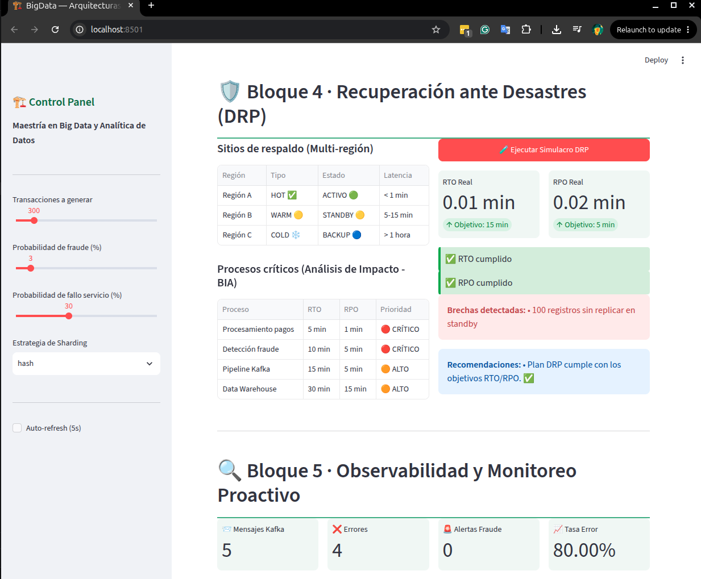

**Figura 8.** Resultado inicial del simulacro mostrado en la interfaz.

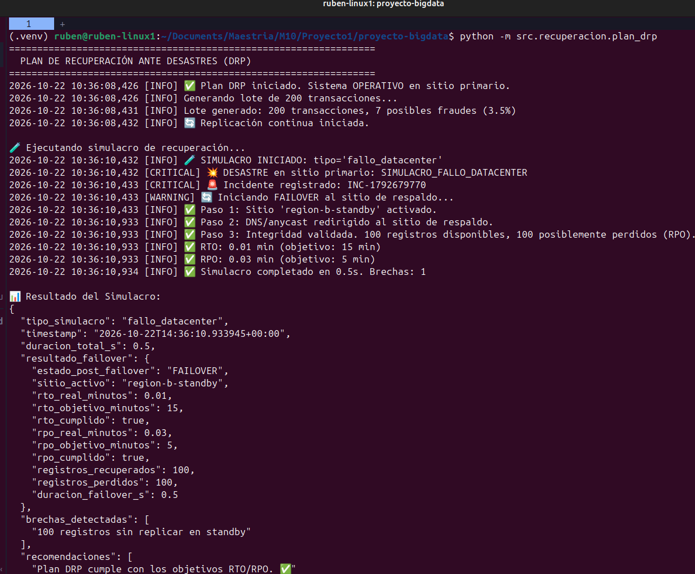

**Figura 9.** Línea base: 100 de 200 registros no estaban en standby.

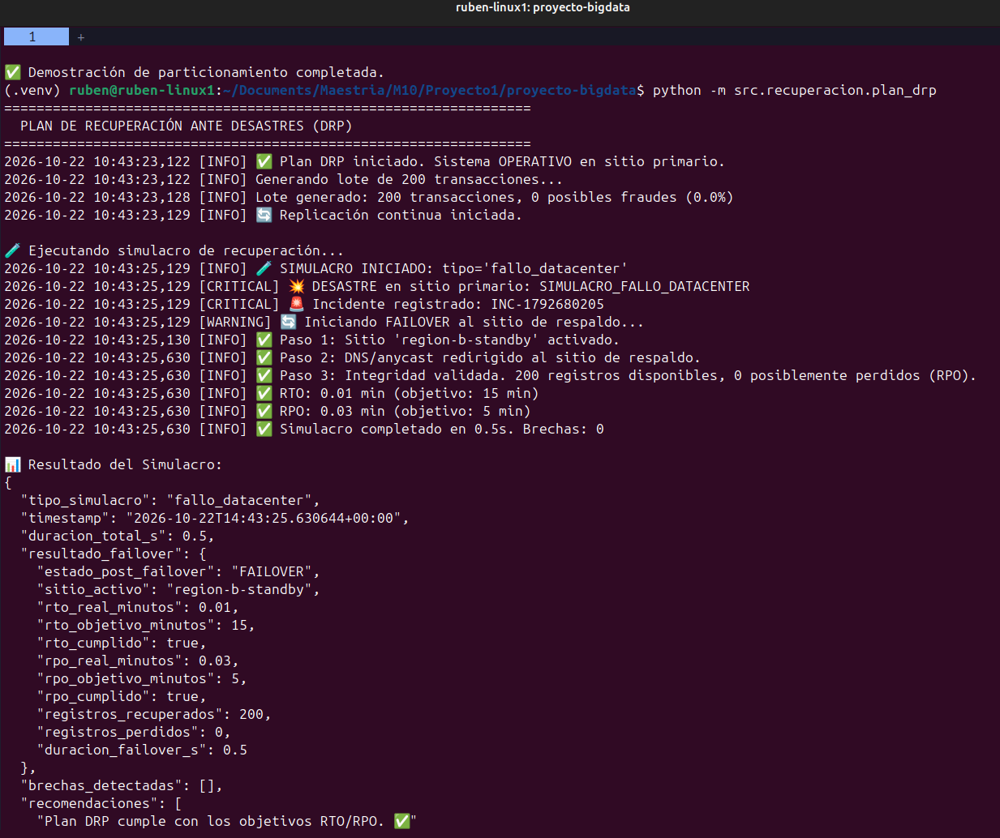

**Figura 10.** Después del cambio: los 200 registros se encontraron en standby y no se reportaron brechas.

#### Bloque 5: sharding, replicación y CAP

El módulo genera 600 transacciones, inserta lotes en la estrategia hash y geográfica, muestra una separación vertical por perfil/transacción/comercio/riesgo y compara estrategias de replicación. En la corrida inicial del usuario, el hash asignó 167 registros a `shard_0`, 333 a `shard_1` y ninguno a `shard_2`; el balance fue 0 % y se marcó hotspot. La causa fue el uso preferente de `shard_key`, con únicamente etiquetas `shard_0`–`shard_2`, como entrada a una segunda distribución por anillo.

Después de priorizar `cliente_id`, una corrida de 500 transacciones distribuyó 155, 169 y 176 registros entre los tres shards. La métrica de balance del módulo quedó en 88,1 % y no detectó hotspot. La comparación se representa en la Figura 30. Una corrida de 500 filas es ilustrativa; no demuestra por sí sola balance esperado en todas las cargas ni bajo distribuciones adversas.

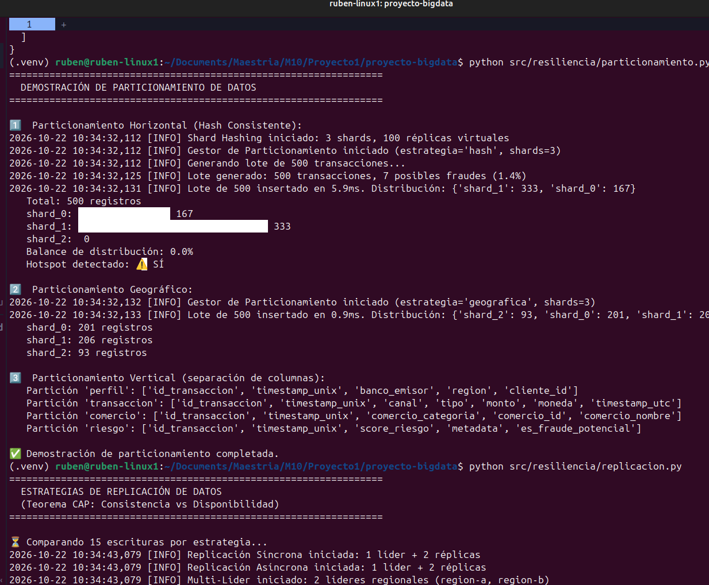

**Figura 11.** Línea base con el shard 2 sin registros.

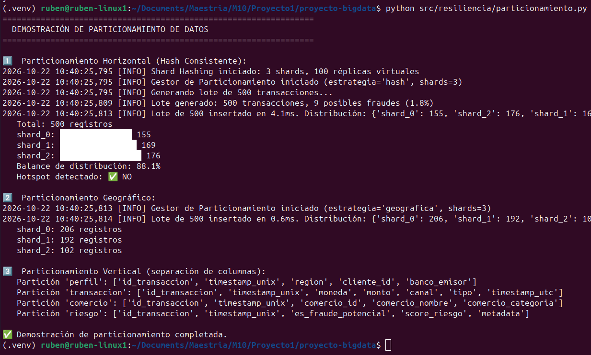

**Figura 12.** Resultado posterior con uso de los tres shards y balance de 88,1 %.

En una ejecución individual, la comparación de escrituras mostró aproximadamente 21,7 ms de latencia media síncrona, 1,5 ms asíncrona y 5,3 ms multi-líder. Estas cifras proceden de sleeps y variaciones aleatorias, no de nodos de red reales. La principal utilidad de la tabla es hacer visible el compromiso pedagógico entre espera por confirmaciones y propagación posterior.

### 6.3 Ejecución de módulos individuales

Se ejecutaron de forma independiente el simulador, el Circuit Breaker, el particionador, el simulador de replicación, el motor batch, la observabilidad y el DRP. El intento `python src/recuperacion/plan_drp.py` falló con `ModuleNotFoundError: No module named 'src'`, debido a la ruta de importación para ejecución directa. Ejecutarlo desde la raíz como `python -m src.recuperacion.plan_drp` resolvió la importación. Por este motivo se actualizó el README.

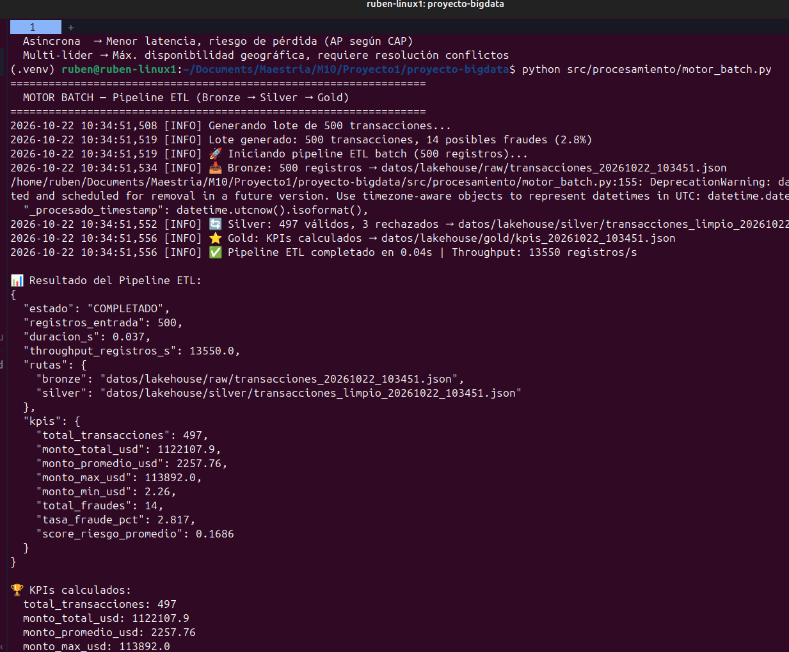

**Figura 13.** Ejecución individual del motor batch antes de corregir la marca temporal obsoleta.

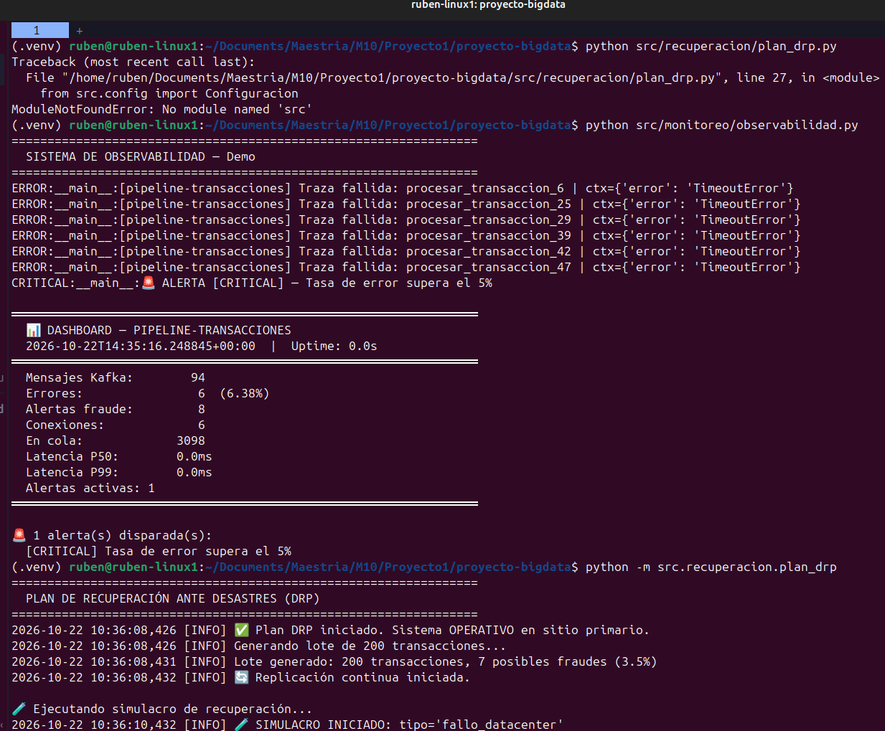

**Figura 14.** Salida que permite distinguir el error de invocación directa del resultado del módulo de observabilidad.

### 6.4 Captura en Visual Studio Code

Se recibió una captura auténtica de la terminal integrada de VS Code. En ella se observa un primer intento del motor batch que falló por `timezone` no importado y, después del ajuste, la ejecución que completó las tres capas. Esta evidencia documenta el proceso completo de corrección, incluido el error intermedio, y demuestra que el proyecto se ejecutó desde VS Code.

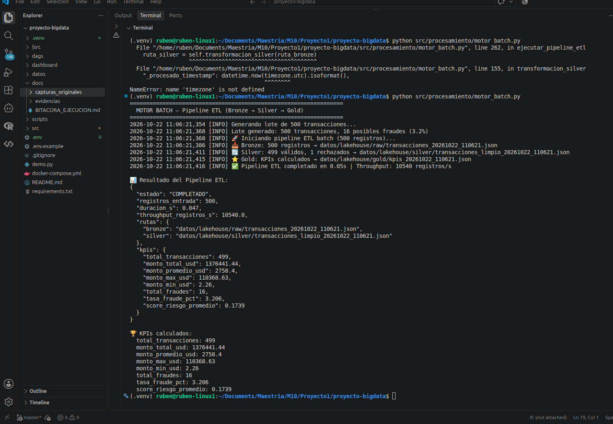

**Figura 15.** Captura en VS Code: error inicial durante la corrección y ejecución posterior exitosa del ETL, con 500 entradas, 499 válidas y 1 rechazada.

### 6.5 Pruebas de regresión

Para reducir el riesgo de reintroducir los defectos corregidos se incorporaron tres pruebas automatizadas. Estas comprueban que la latencia simulada no sea negativa, que una muestra de 500 clientes use los tres shards y que el DRP replique el lote inicial completo y solo los nuevos registros en las sincronizaciones posteriores.

El usuario ejecutó `python -m pytest tests/test_mejoras_aplicadas.py -v` desde el entorno `.venv` de Python 3.12.3. La salida mostró tres casos aprobados en 0,16 segundos. La prueba DRP sustituye la espera simulada de sincronización por una función local para medir la lógica de copia sin introducir latencia artificial. Estos casos cubren escenarios concretos; no sustituyen pruebas de integración con Kafka, Docker ni un entorno distribuido.

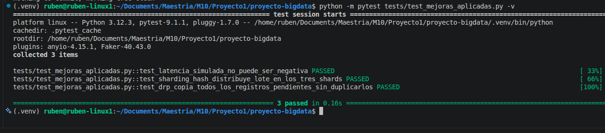

**Figura 16.** Terminal integrada de VS Code: las tres pruebas de regresión pasaron en 0,16 segundos.

### 6.6 Ejecuciones recientes en Visual Studio Code

Después de incorporar la extracción de la sincronización DRP y las pruebas de regresión, el usuario volvió a ejecutar `python demo.py` desde VS Code. La demo finalizó en 4,69 segundos. En el bloque ETL de esa corrida ingresaron 300 registros y Gold presentó 294; en el simulacro se recuperaron 150 registros, no se reportaron pérdidas, y el hash distribuyó 600 registros en 183/211/206, con balance reportado de 86,7 % y sin hotspot. Las comparaciones de tecnología y resiliencia de la demo son ilustrativas; no se midieron motores ni centros de datos externos.

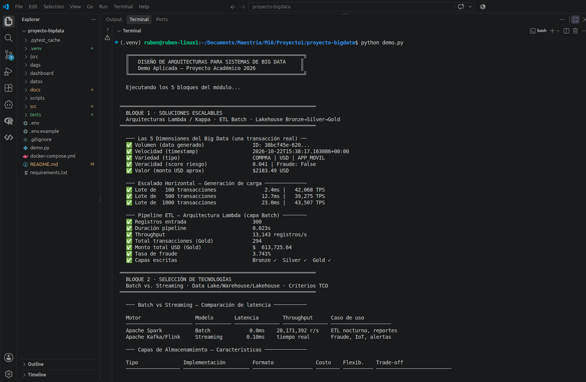

**Figura 17.** Datos sintéticos, escalado por lotes y ETL del bloque 1; comienza la comparación del bloque 2.

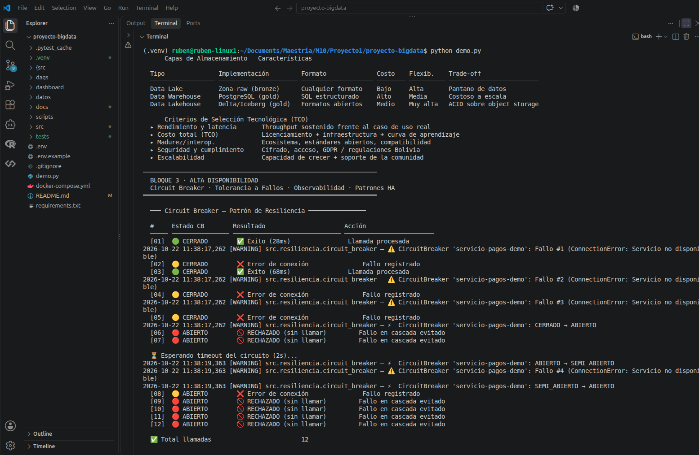

**Figura 18.** Criterios de selección y secuencia de llamadas que lleva al Circuit Breaker a rechazar operaciones.

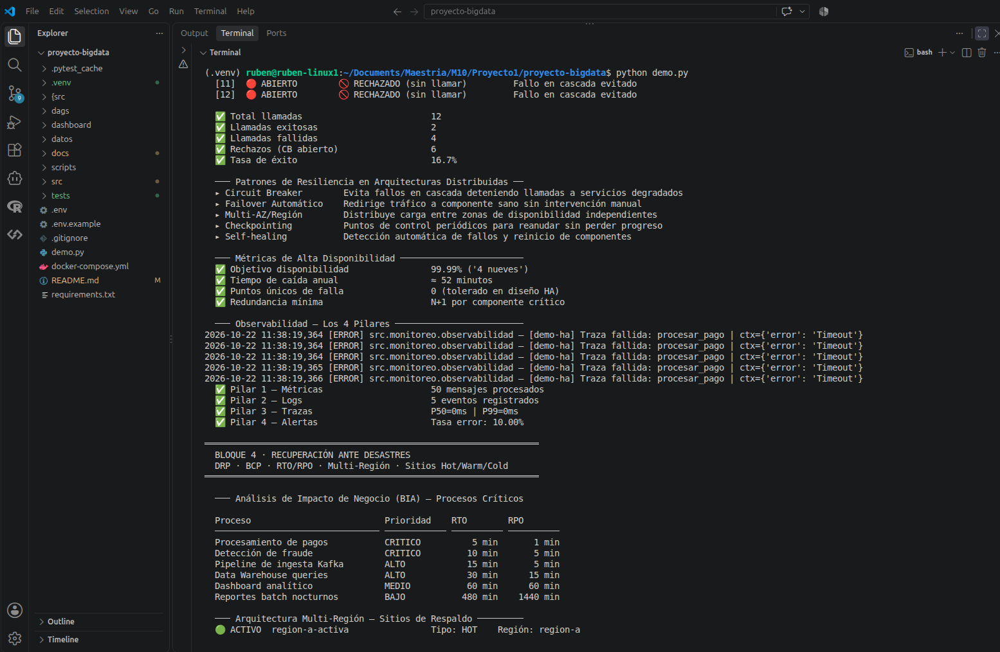

**Figura 19.** Métricas de disponibilidad y observabilidad; inicio de la sección de recuperación ante desastres.

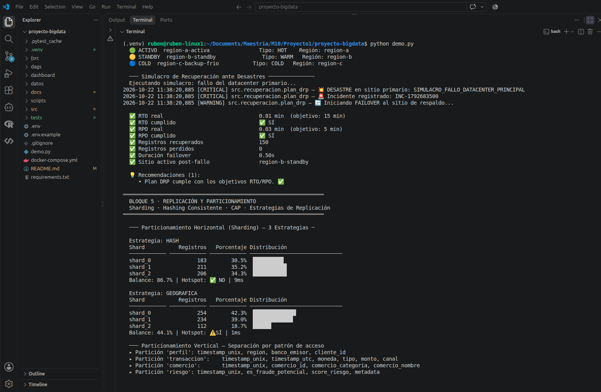

**Figura 20.** Simulacro DRP con 150 recuperados y cero registros perdidos; transición al bloque de particionamiento.

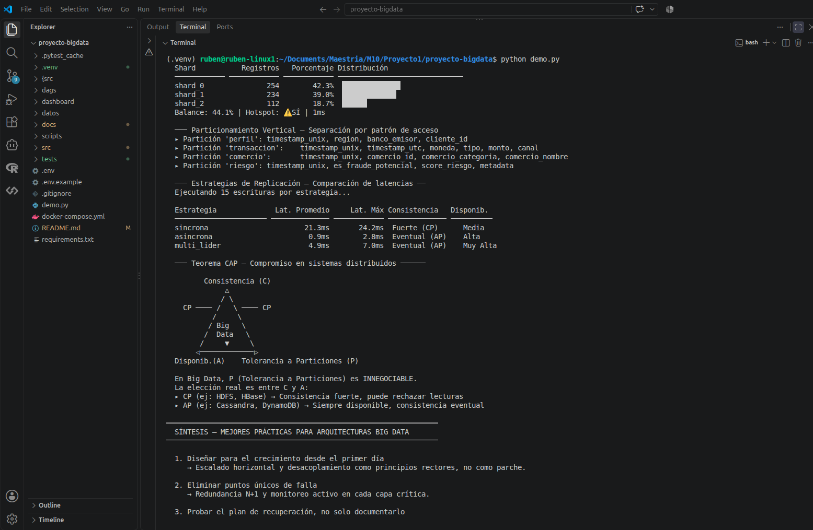

**Figura 21.** Resultados de hash, replicación síncrona/asíncrona/multi-líder y explicación conceptual de CAP.

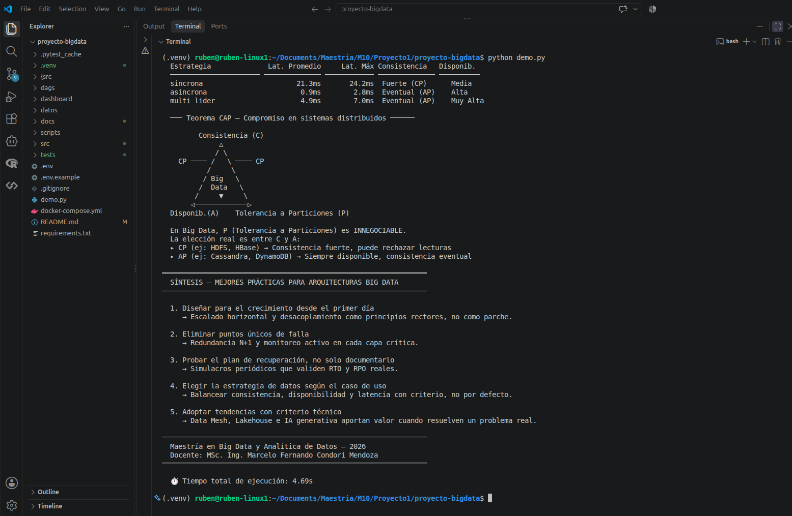

**Figura 22.** Recomendaciones presentadas por la demo y duración total de 4,69 segundos.

Además de la demo integral, el usuario ejecutó módulos individuales. En el sharding hash de una muestra de 500 registros se observaron 150, 189 y 161 registros por shard, con balance de 79,4 % y sin hotspot. En otra corrida del DRP, 200 de 200 registros estaban disponibles en standby, con cero pérdidas; se informaron RTO de 0,01 min y RPO de 0,03 min. El motor ETL procesó 500 entradas, conservó 494, rechazó 6 y calculó un throughput de 12.043 registros/s. La observabilidad procesó 98 mensajes, registró 2 errores (2,04 %), 8 alertas de fraude y ninguna alerta activa. Son resultados de corridas separadas y, excepto la cifra de entrada configurada, pueden variar.

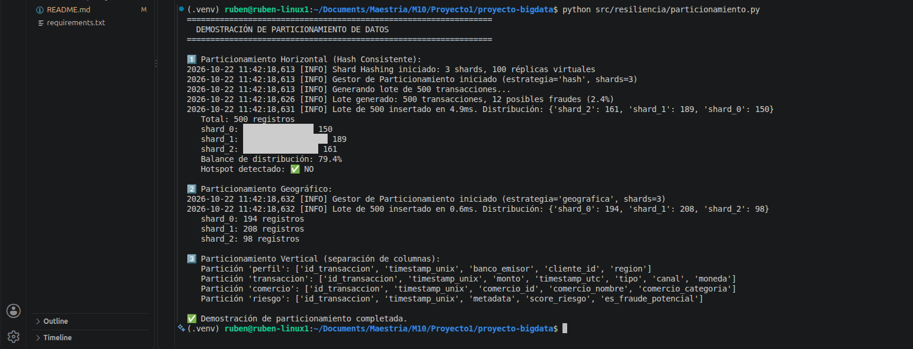

**Figura 23.** Ejecución individual: tres shards poblados, balance de 79,4 % y ausencia de hotspot en la muestra.

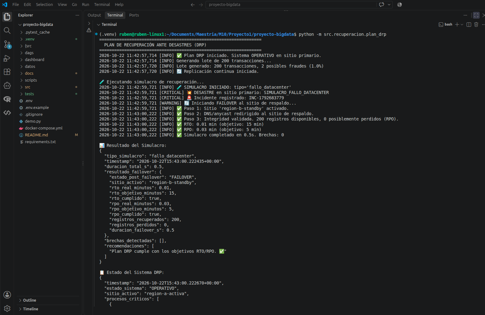

**Figura 24.** Simulacro individual con 200 registros recuperados, cero perdidos y objetivos temporales RTO/RPO cumplidos.

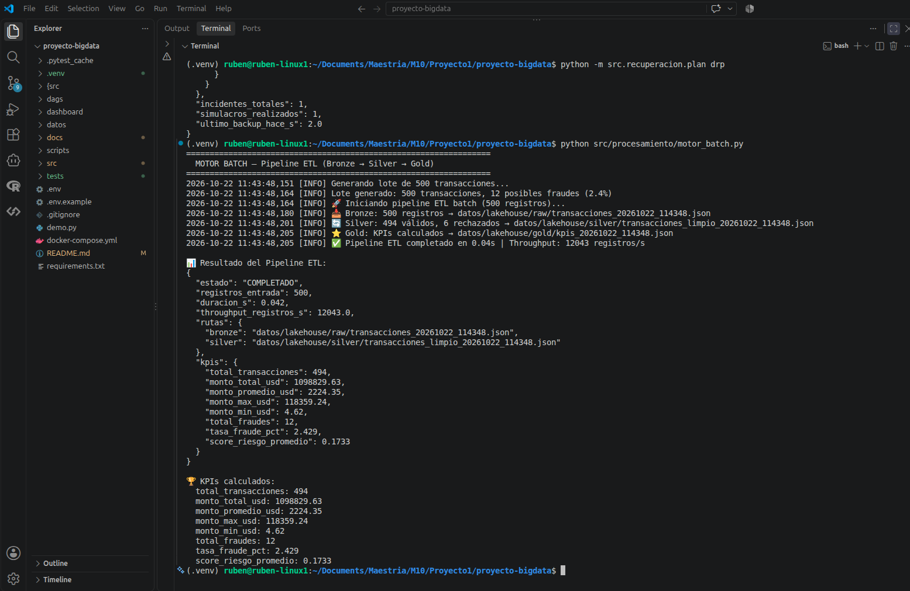

**Figura 25.** Resultado individual Bronze/Silver/Gold con 500 entradas, 494 registros Silver y 6 rechazados.

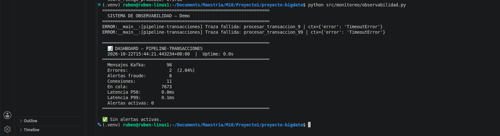

**Figura 26.** Métricas de 98 mensajes, dos errores, ocho alertas de fraude y cero alertas activas en esta corrida.

### 6.7 Diagramas explicativos

El esquema de la Figura 1 distingue el camino local que sí se ejecutó de los servicios Docker descritos en la configuración. La Figura 27 amplía la transformación por capas, incluyendo la salida de registros rechazados. La Figura 28 muestra las etapas del simulacro DRP y que, al finalizar, el prototipo restaura el estado previo. La Figura 29 resume los estados del Circuit Breaker. La Figura 30 ofrece una comparación visual de la distribución hash de línea base y de la corrida posterior a la mejora. En todas las figuras, los elementos locales representan el comportamiento observado; no se atribuye operación a infraestructura que no se levantó.

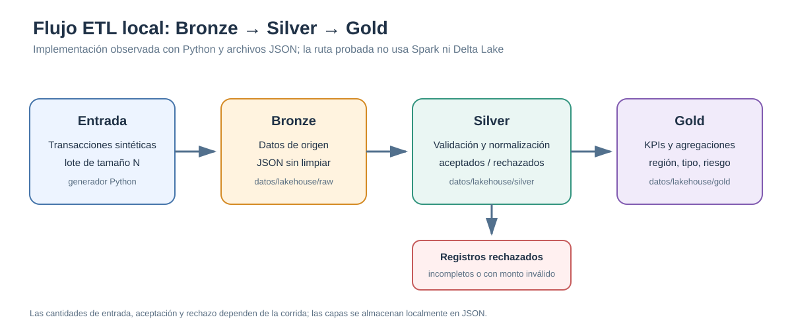

**Figura 27.** Proceso Bronze → Silver → Gold con ramificación de registros rechazados.

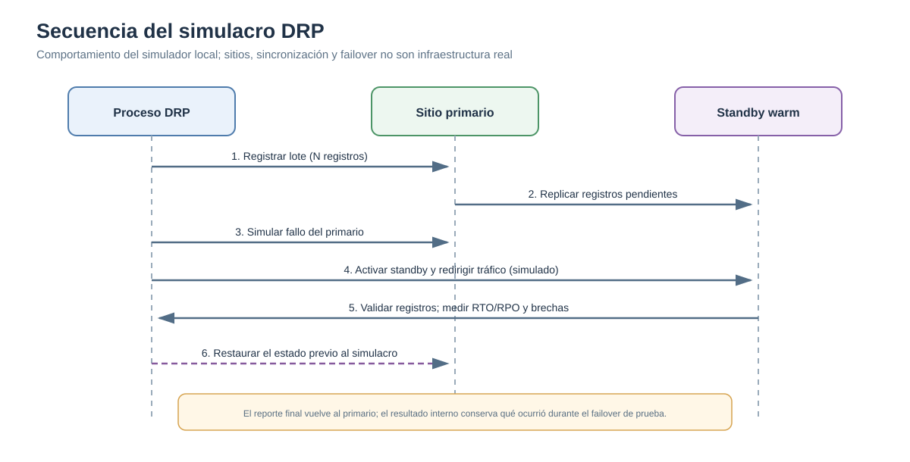

**Figura 28.** Registro, sincronización, fallo, failover, validación y restauración del estado de la aplicación de prueba.

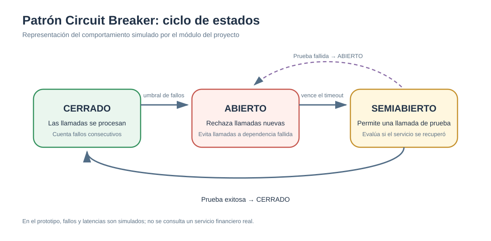

**Figura 29.** Transiciones entre cerrado, abierto y semiabierto ante fallos, timeout y llamada de prueba.

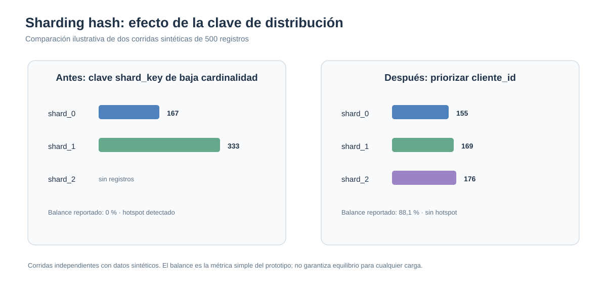

**Figura 30.** Distribución observada en dos corridas sintéticas de 500 registros; los valores son ilustrativos, no una garantía estadística.

## 7. Mejoras aplicadas y comparación

| N.º | Archivo | Hallazgo | Cambio | Evidencia de resultado |
|---:|---|---|---|---|
| 1 | `src/resiliencia/replicacion.py` | Una latencia base de 1 ms más ruido aleatorio de −2 a 2 ms podía producir un valor negativo y detener `time.sleep()`. | Se limitó la latencia simulada con `max(0.0, ...)`. | Bloque 5 y demo integral concluyeron después del cambio; la demo compartida terminó en 4,75 s y luego 4,73 s. |
| 2 | `src/resiliencia/particionamiento.py` | Se volvía a hashear una clave con solo tres etiquetas, dejando un shard vacío. | Se priorizó `cliente_id`, de mayor cardinalidad en los datos generados. | En 500 registros: de 167/333/0 a 155/169/176; balance reportado 88,1 %. |
| 3 | `src/recuperacion/plan_drp.py` | El ciclo copiaba únicamente los últimos 100 registros al standby. | Se copiaron los registros posteriores al conteo ya sincronizado. | En una muestra de 200: de 100 recuperados/100 perdidos a 200/0 y cero brechas. |
| 4 | `src/procesamiento/motor_batch.py` y `README.md` | `datetime.utcnow()` generaba advertencia de obsolescencia; la instrucción directa del DRP no resolvía `src`. | Se usó `datetime.now(timezone.utc)` y se cambió el comando del README a `python -m src.recuperacion.plan_drp`. | El ETL completó en 0,047 s, sin advertencia, con 500 entradas y 499 válidas. |
| 5 | `src/recuperacion/plan_drp.py`, `tests/test_mejoras_aplicadas.py` y `README.md` | El repositorio documentaba comandos de pytest, pero no tenía una carpeta de pruebas; la sincronización DRP estaba integrada dentro del hilo y era difícil de comprobar aisladamente. | Se extrajo `_replicar_pendientes()` y se añadieron pruebas de regresión para latencia no negativa, uso de los tres shards y sincronización DRP incremental sin duplicados. Se actualizó el comando de pytest del README. | El usuario ejecutó `python -m pytest tests/test_mejoras_aplicadas.py -v`: 3 pruebas pasaron en 0,16 s; la captura de VS Code quedó archivada como evidencia 27. |

Las mejoras de latencia, sharding y DRP se registraron en commits individuales; la modificación UTC y su documentación se guardaron en `cd58e10`. Las pruebas de regresión y la extracción del método DRP son cambios posteriores aún pendientes de commit. El usuario informó que las tres pruebas pasaron; para la evidencia visual y el cumplimiento estricto del requisito docente aún se deben guardar capturas adicionales de VS Code.

## 8. Limitaciones

1. **Datos sintéticos:** los registros no proceden de una entidad financiera ni contienen una detección validada de fraude. Los porcentajes y tasas son aleatorios.
2. **Escala local:** las muestras de cientos de registros no demuestran escalabilidad de Big Data. Los TPS y throughput dependen del equipo, del tamaño pequeño de la muestra y de la implementación local.
3. **ETL local:** el flujo observado utiliza JSON. PySpark está en dependencias y en configuración, pero no se usó en el camino ejecutado. No se escribió una tabla Delta en esta evidencia.
4. **Servicios externos:** Kafka, Airflow, PostgreSQL, SeaweedFS y el stack Docker no fueron levantados ni conectados en las ejecuciones documentadas.
5. **Resiliencia simulada:** latencia, nodos, réplicas, sitios, DNS, failover y resultados RTO/RPO se modelan en el proceso Python. No se midió una recuperación real de servicio o centro de datos.
6. **Hash de cliente:** la transformación local genera un hash SHA-256 truncado de 16 caracteres, sin sal configurada. Debe describirse como seudonimización demostrativa, no como anonimización robusta.
7. **Métricas aleatorias:** los resultados pueden variar entre corridas. Deben citarse junto al comando y el escenario de ejecución.
8. **Capturas VS Code:** el repositorio contiene 37 imágenes; doce muestran explícitamente ejecuciones desde VS Code. Conviene añadir al menos tres capturas auténticas adicionales desde ese entorno, si la interpretación del docente exige que las 15 capturas sean de VS Code.
9. **Advertencia Git:** Git informó de objetos sueltos inalcanzables, pero no se encontraron commits inalcanzables; el historial del proyecto se mantuvo intacto y el árbol se reportó limpio después de los commits. Esta advertencia de mantenimiento no es un resultado funcional de la aplicación.

## 9. Conclusiones

1. El repositorio permite observar en una sola aplicación didáctica conceptos de ingesta, ETL, capas de datos, tolerancia a fallos, sharding, replicación, observabilidad y recuperación ante desastres.
2. La ejecución desde Python 3.12.3 y `.venv` permitió correr la demo, el dashboard y los módulos locales sin iniciar Docker. Esto facilitó revisar la lógica de simulación, pero no valida la operación de los servicios distribuidos anunciados en la arquitectura general.
3. La corrección de la latencia negativa evitó que una variación aleatoria hiciera fallar la comparación de replicación y permitió completar la demo de cinco bloques.
4. Priorizar una clave de mayor cardinalidad mejoró el resultado observado del sharding: los tres shards recibieron registros y la aplicación dejó de señalar un hotspot en esa muestra.
5. La sincronización incremental de todos los registros pendientes eliminó la brecha observada en el escenario DRP de 200 transacciones. El simulacro también permitió distinguir el estado de failover durante la prueba del estado restaurado al concluirla.
6. Reemplazar `datetime.utcnow()` eliminó la advertencia de obsolescencia en la corrida ETL, y actualizar la instrucción del README permitió ejecutar el DRP como módulo desde la raíz.
7. Los resultados cuantitativos son útiles para describir el comportamiento del prototipo, pero no deben presentarse como SLA, benchmark de clúster ni garantía de disponibilidad de un sistema bancario real.
8. Las tres pruebas de regresión ejecutadas pasaron en 0,16 s, lo que aporta una verificación repetible de la latencia simulada, la distribución hash y la replicación DRP incremental dentro de sus escenarios de prueba.

## 10. Recomendaciones

1. Completar al menos 15 capturas auténticas desde VS Code que muestren comandos, archivos relevantes y resultados de ejecución, y guardar sus nombres y pies de figura en el índice.
2. Incorporar al informe la diferencia entre simulación y servicio real. Usar expresiones como “el simulador reportó” y “en esta corrida”, especialmente para latencia, RTO, RPO, fraude y balance.
3. Evaluar una clave hash determinista de alta cardinalidad que combine cliente y región, documentar el algoritmo y medir muchas semillas y tamaños de lote; evitar interpretar una muestra de 500 como prueba general.
4. En el DRP, registrar identificadores de registros sincronizados o un offset/checkpoint explícito, y calcular el punto de recuperación a partir del último registro recuperable. El conteo de registros perdidos y el RPO temporal deben ser coherentes y presentarse como medidas diferentes.
5. Proteger credenciales mediante variables de entorno o un gestor de secretos. No empaquetar `.env` ni valores reales de contraseñas en el ZIP.
6. Evitar afirmar anonimización fuerte para un hash sin sal; utilizar tokenización o HMAC con una clave protegida si el caso de uso lo requiriera.
7. Separar una ruta de demo liviana de una instalación de stack completo y documentar qué comandos requieren Docker, Java, Spark o Airflow.
8. Ampliar las pruebas automatizadas con escenarios de RPO y fallos de sincronización; mantener la ejecución de la suite antes de futuras modificaciones de resiliencia.
9. Revisar el `docker-compose.yml` antes de presentar propiedades de alta disponibilidad: la configuración inspeccionada usa un broker Kafka y factor de replicación 1; sus comentarios no bastan para demostrar tolerancia a fallos.
10. Para la entrega, crear el `.docx` con estilos de títulos, índice automático, pies de figura, numeración de páginas y al menos 14 páginas; después revisar el documento exportado visualmente. Comprimir por separado el proyecto actualizado, excluyendo `.venv`, `.env`, cachés y archivos temporales.

## 11. Referencias

[1] Lin, J. (2017). The Lambda and the Kappa. *IEEE Internet Computing, 21*(5), 60–66. https://cs.uwaterloo.ca/~jimmylin/publications/Lin_IEEE2017b.pdf

[2] Apache Software Foundation. (s. f.). *Apache Kafka documentation: Introduction and design*. https://kafka.apache.org/documentation/

[3] Databricks. (2026, 11 de septiembre). *What is the medallion lakehouse architecture?* https://docs.databricks.com/gcp/en/lakehouse/medallion

[4] Delta Lake. (s. f.). *Delta Lake documentation*. https://docs.delta.io/

[5] Gilbert, S., & Lynch, N. A. (2012). Perspectives on the CAP Theorem. *Computer, 45*(2), 30–36. https://doi.org/10.1109/MC.2011.389

[6] Fowler, M. (2014, 6 de marzo). *Circuit Breaker*. https://martinfowler.com/bliki/CircuitBreaker.html

[7] OpenTelemetry. (s. f.). *Signals*. https://opentelemetry.io/docs/concepts/signals/

[8] Swanson, M., Bowen, P., Phillips, A., Gallup, D., & Lynes, D. (2010). *Contingency Planning Guide for Federal Information Systems* (NIST SP 800-34 Rev. 1). National Institute of Standards and Technology. https://doi.org/10.6028/NIST.SP.800-34r1

[9] Python Software Foundation. (2026). *datetime — Basic date and time types*. Python 3 documentation. https://docs.python.org/3/library/datetime.html

[10] Apache Software Foundation. (2024). *DAGs — Apache Airflow 2.10.4 documentation*. https://airflow.apache.org/docs/apache-airflow/2.10.4/core-concepts/dags.html

## 12. Anexos

### Anexo A. Comandos locales documentados

```bash
# Activar entorno
source .venv/bin/activate

# Ejecutar demo completa o un bloque
python demo.py
python demo.py --bloque 1
python demo.py --bloque 5

# Abrir dashboard
streamlit run dashboard/app_streamlit.py

# Ejecutar módulos individuales desde la raíz
python src/ingesta/simulador_transacciones.py
python src/resiliencia/circuit_breaker.py
python src/resiliencia/particionamiento.py
python src/resiliencia/replicacion.py
python src/procesamiento/motor_batch.py
python -m src.recuperacion.plan_drp
python src/monitoreo/observabilidad.py
```

### Anexo B. Capturas candidatas

El catálogo con 37 capturas, su descripción y notas de línea base/posterior se encuentra en [`evidencias/INDICE_EVIDENCIAS.md`](evidencias/INDICE_EVIDENCIAS.md). Para el Word, seleccionar figuras variadas y legibles, mantener las capturas originales y añadir pies que indiquen el comando y el hallazgo que se observa.

### Anexo C. Pendientes antes de convertir a Word

- [ ] Completar institución, autoría o integrantes y ciudad.
- [ ] Añadir al menos 3 capturas adicionales de ejecución en VS Code si se requiere que las 15 sean explícitamente de ese entorno.
- [ ] Revisar que la corrida escogida para cada cifra coincide con la captura citada.
- [ ] Dar formato APA 7 o el estilo requerido por el docente y comprobar los datos bibliográficos.
- [ ] Generar índice automático, numerar figuras y verificar que el `.docx` final tenga 14 páginas o más.
- [ ] Incluir conclusiones y recomendaciones revisadas por el grupo.
- [ ] Comprimir el proyecto final sin `.env`, `.venv`, cachés ni salidas temporales de ejecución.
