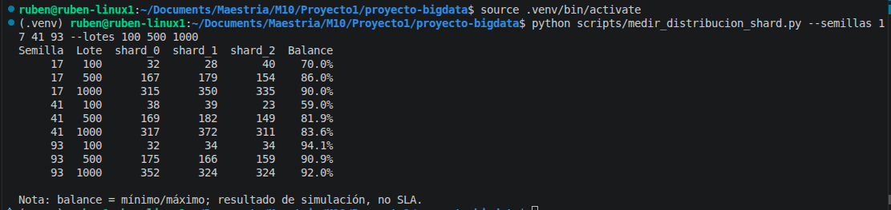

# Reporte de indicadores clave del proyecto

**Proyecto:** Diseño de una arquitectura Big Data para el monitoreo de transacciones financieras

**Fecha de corte:** 22 de octubre de 2026
**Entorno:** Python 3.12.3, Linux, ejecución local con datos sintéticos.

## Propósito

Este reporte reúne indicadores observados que pueden respaldar las conclusiones del trabajo. Los resultados provienen de corridas independientes, salvo donde se indica lo contrario. La aplicación es un prototipo didáctico: las cifras describen su simulación local y no representan un sistema financiero, un clúster distribuido ni objetivos de servicio validados.

## Indicadores

| Indicador | Resultado observado | Lectura para las conclusiones | Evidencia/alcance |
|---|---:|---|---|
| Cobertura funcional de la demo | 5 de 5 bloques completados; 4,69 s en una corrida integral | Los módulos pueden recorrerse en una sola ejecución local. El tiempo es orientativo, no benchmark. | Capturas 28–33; la duración puede variar. |
| Calidad de datos del ETL | 500 entradas; 499 en Silver; 1 rechazado. Aceptación: **99,8 %**; rechazo: **0,2 %** | La validación retuvo la mayoría de los registros de esa muestra y descartó uno por reglas de calidad. | Captura 26; lote sintético específico. Otra corrida independiente obtuvo 494/500. |
| Distribución hash, línea base vs. mejora | Línea base: **167/333/0**, un shard vacío. Después: **155/169/176**, los tres shards activos; balance mínimo/máximo **88,1 %** | Priorizar una clave de mayor cardinalidad corrigió el shard vacío en la muestra. | Capturas 20 y 24; 500 transacciones en ambas corridas reportadas. |
| Reproducibilidad región-cliente | La clave fija `CLI-1234` + `Centro` se asignó a `shard_2` en **5/5 procesos**. En nueve corridas de 100/500/1.000 registros, el balance varió entre **59,0 % y 94,1 %**. | SHA-256 estabiliza la asignación entre procesos; el balance todavía depende del tamaño y composición de la muestra. Hash más módulo no ofrece redistribución mínima al cambiar el número de shards. | `scripts/medir_distribucion_shard.py`; registros en `evidencias/38-medicion-shard-determinista.txt` y captura de terminal en `evidencias/39-medicion-shard-terminal.png`. El mínimo de 59,0 % ocurrió con n=100. |
| Recuperación DRP simulada | Línea base: 100/200 recuperados. Después: **200/200**, cero registros posiblemente perdidos. RTO **0,01 min** y RPO **0,03 min** informados por el simulador. | La sincronización incremental cubrió los registros pendientes en el escenario probado. Los tiempos son del simulador y no validan una recuperación real. | Capturas 23, 25 y 35; ensayo local con 200 registros. |
| Pruebas de regresión de resiliencia | **3/3 pruebas aprobadas** en 0,16 s | Las pruebas cubren latencia no negativa, distribución en tres shards y replicación DRP incremental sin duplicados. No equivalen a cobertura integral. | Captura 27, ejecutada desde VS Code con pytest. |
| Observabilidad simulada | 98 mensajes; 2 errores (**2,04 %**); 8 alertas de fraude; 0 alertas activas | El prototipo expone métricas y alertas para inspección. Estos conteos dependen de probabilidades aleatorias. | Captura 37; corrida individual. |

**Evidencia visual complementaria.** La terminal muestra el comando y la tabla completa; no se atribuye a una ventana de VS Code porque el marco de la aplicación no aparece en la captura.

## Actualizaciones puntuales realizadas en el desarrollo

| Componente | Cambio aplicado | Resultado observado |
|---|---|---|
| Replicación | Evitar latencia simulada negativa. | El bloque de replicación finaliza y la regresión correspondiente pasa. |
| Particionamiento | Usar `cliente_id` en vez de rehashear etiquetas `shard_N`. | La muestra de 500 pasó de un shard vacío a tres shards poblados. |
| Generador de transacciones | Asignar shard con SHA-256 determinista sobre región-cliente. | La misma clave se conservó en el mismo shard a través de cinco procesos. |
| Recuperación DRP | Copiar incrementalmente todos los registros que aún no están en standby. | El escenario pasó de 100/200 a 200/200 registros recuperados. |
| ETL e instrucciones | Usar fecha UTC vigente y documentar la invocación DRP como módulo. | Corrida ETL sin advertencia UTC y comando de módulo que resuelve la importación. |
| Regresión | Añadir tres pruebas dirigidas a las correcciones de resiliencia. | 3/3 pruebas aprobadas en 0,16 s, según la ejecución reportada. |

La descripción completa del hallazgo, cambio, archivos afectados y evidencia está en la subsección **7.6 Actualizaciones puntuales realizadas en el desarrollo** del informe principal.

## Síntesis para las conclusiones

1. La demo logró ejecutar cinco áreas didácticas en el entorno local y procesó lotes de prueba mediante el flujo Bronze → Silver → Gold.
2. La validación ETL presentó 99,8 % de aceptación en una muestra de 500 registros; debe informarse como resultado de esa corrida sintética.
3. La corrección del sharding eliminó el shard vacío en la comparación de 500 registros y alcanzó 88,1 % de balance mínimo/máximo en la corrida posterior. Las mediciones adicionales muestran que lotes pequeños aún pueden presentar desequilibrio.
4. La clave hash determinista permite repetir la asignación de un cliente y región en procesos distintos. Esta estabilidad mejora la reproducibilidad, pero no garantiza balance perfecto ni evita reasignaciones masivas al modificar el número de shards.
5. En el escenario DRP simulado, el cambio de sincronización incremental elevó los registros recuperados de 100/200 a 200/200. Este resultado valida la lógica del caso de prueba, no la continuidad de un servicio real.
6. Las pruebas automatizadas aprobadas y las métricas de observabilidad ofrecen una base pequeña de verificación; conviene ampliarla antes de considerar el prototipo apto para cargas o fallos de producción.

En las pruebas locales, la demo completó sus cinco bloques y el ETL conservó 499 de 500 registros de una corrida (99,8 % de aceptación). La mejora de particionamiento pasó de una distribución con un shard vacío (167/333/0) a una muestra con los tres shards poblados (155/169/176; balance 88,1 %). La asignación región-cliente con SHA-256 se mantuvo estable para una clave fija en cinco procesos independientes; sin embargo, el balance de nueve muestras varió entre 59,0 % y 94,1 %, con menor equilibrio en una muestra de 100 registros. En el simulacro DRP, la sincronización incremental elevó la recuperación reportada de 100/200 a 200/200 registros, y las tres pruebas de regresión existentes pasaron. Estos resultados respaldan la corrección funcional de escenarios puntuales; al proceder de datos sintéticos y ejecución local, no constituyen benchmarks, SLA ni demostración de una plataforma distribuida productiva.

## Precauciones de interpretación

- No promediar o combinar filas de corridas independientes como si provinieran del mismo lote.
- Reportar el tamaño de muestra, el comando y la evidencia junto con cada porcentaje.
- La métrica de balance usada es `mínimo de registros por shard / máximo de registros por shard × 100`.
- Los valores de fraude, errores, latencia y tiempos DRP dependen de la simulación.
- Kafka, PostgreSQL, SeaweedFS, Airflow, Spark y Delta no se validan con estos indicadores locales.
